# Emberline

**Lead frozen villagers to the fire, then build a village that keeps them alive.**

Emberline is a casual mobile game made for quick sessions and entry-level phones. In each short
run you guide a growing line of frozen travellers across the ice to the campfire in the middle. The people you save
move into your village, where you build, upgrade and defend it, and keep the great hearth burning.

Current version: **3.8.0** (see [CHANGELOG.md](CHANGELOG.md))

  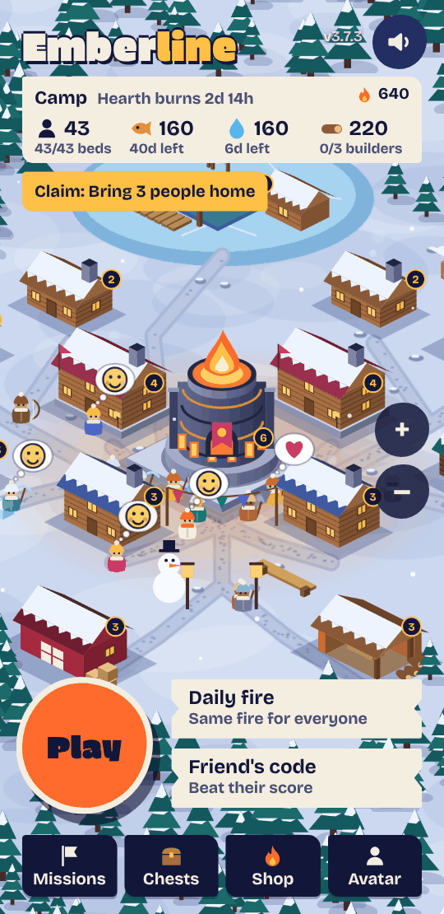
  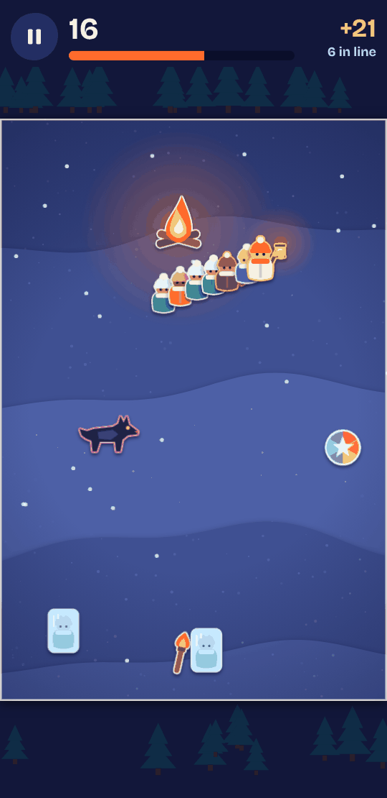
  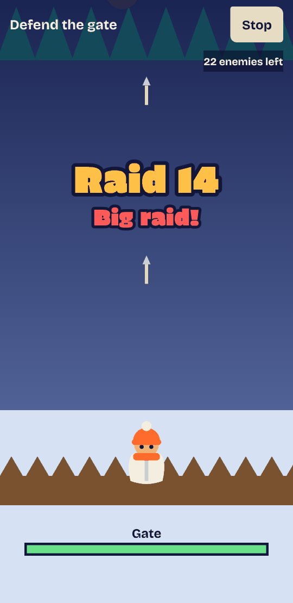

---

## The game

### Runs: save people from the cold
- **Lead the line:** drag to steer. Every frozen traveller you touch joins your line, and the longer the line, the more each one is worth.
- **Bank at the campfire:** it always sits in the middle. Reaching it banks the line and warms you up. Wait too long for a longer line and the cold catches you.
- **A guide for new players:** the first time something appears (wolves, ice, torches, gold ice, the rainbow power), the game pauses, zooms in and names it in one line.
- **Danger grows:** the run gets faster as it goes. Ice spikes block the way, and wolves go for your villagers first. Once a wolf catches the line, you lose one person every second until you reach a fire.
- **Golden Aurora:** a rare power-up that smashes wolves and ice and pauses the cold.
- **Instant replay:** every run ends with a replay of what went wrong.
- **Daily fire:** the same run for every player each day. Friend's codes let you challenge someone to beat your score.
- **Fair scores:** runs are deterministic and can be replayed and checked exactly, ready for online leaderboards later.

### The village: keep them alive
- **People and needs:** everyone you rescue lives in your village and needs food, water and a bed. Specialists (fisher, hunter, ice cutter and carpenter) make their building work better.
- **A 2.5D village:** pinch to zoom, drag to pan, and tap a building to upgrade it or start its job. Upgrades take real time and builders.
- **Grow outward:** explore four new lands beyond the trees, and place decorations wherever you like.
- **Missions and chests:** daily and weekly missions pay embers. Chests hold cosmetics and boosts.
- **Your avatar:** choose hats, coats and eyes, and wear them in every run.
- **Feelings you can see:** villagers walk the paths with thought bubbles that show how they feel: happy, cold, angry, sad, sick or hungry.

### The hearth is the lifeline
If the great hearth goes out, people fall ill every few hours, then leave, then die. While it's
out, every button relights it instead, using the stoking mini-game. Nothing else can start until
the fire is burning again.

### Trouble in the village
Every few minutes of play, something goes wrong:
- **Disasters:** a snowstorm coming, a wolf attack, a fire, a landslide.
- **Sickness spreading:** it moves through the cabins, and sick people can't work.
- **People problems:** a fight breaking out, or a slacker.
- **Raids:** each raid is tougher than the last, with shields, runners, brutes, healing shamans and chiefs, plus a bow that sometimes jams. Six raid upgrades and the armoury let you keep up.

Better buildings protect against each kind of trouble, so there's always a reason to upgrade.

### 17 mini-games
Every job and most troubles are a short mini-game, and each one ends with its own celebration
when you do it well.

| Where | Mini-game |
|---|---|
| Fishing dock | Hold to keep the fish in the bar |
| Hunter's lodge | Strike with your axe and dodge when the red ! flashes |
| Ice well | Saw slowly down the line |
| Workshop | Hammer nails on the beat |
| Lumber camp | Chop from left or right, switching sides to dodge branches |
| Smokehouse | Tap the bellows to keep the heat in the green band |
| Tailor | Tap the stitch marks in order to sew coats |
| Smithy | Heat the iron and let go inside the gold mark |
| Storehouse | Flick good food into the store and spoiled food and rats out |
| Great hearth | Drop logs onto a pile that narrows with every overhang |
| Infirmary | Watch the herbs light up, then repeat the order |
| Watchtower | Aim with a swaying arm and shoot moving targets |
| Snowstorm | Drag planks onto the windows against the wind |
| Wolf attack | Hold your torch on each wolf until it runs |
| Fire | Flick buckets up a bucket line before it spreads |
| Landslide | Shovel the snow away from a buried door |
| Raid | Move along the wall while you shoot the raiders |

---

## Screenshots

| | | |
|:---:|:---:|:---:|
|  The village |  A run in progress | 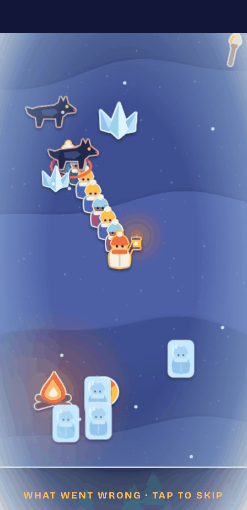 Instant replay |
| 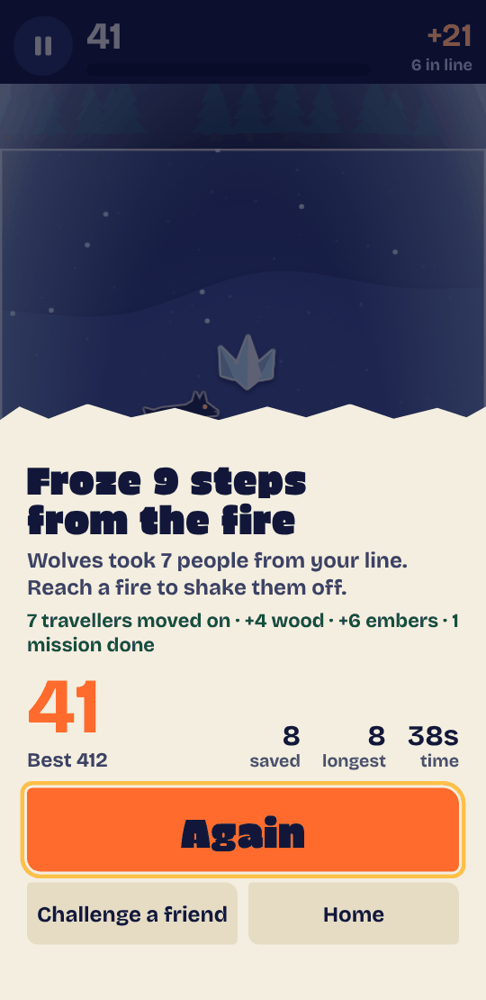 End of a run | 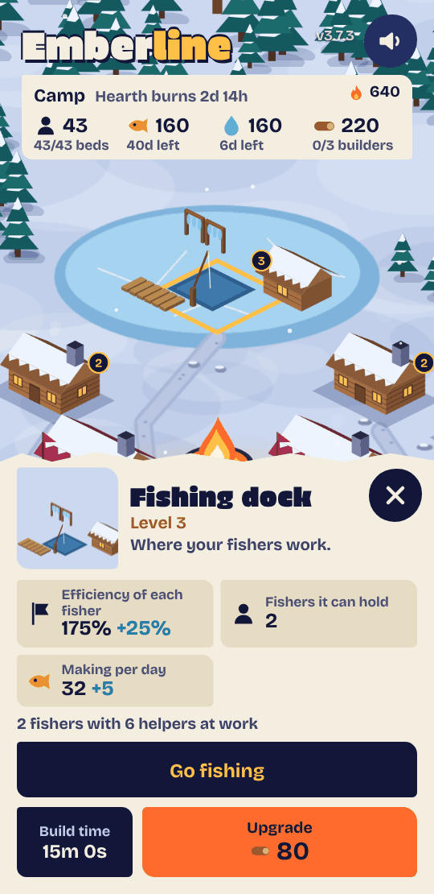 A building and its job | 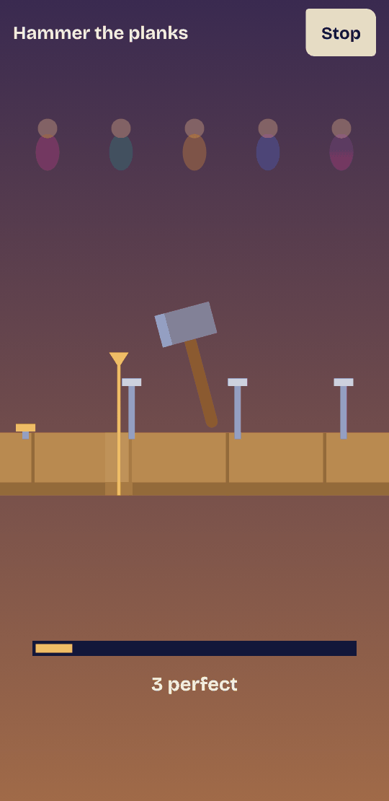 Hammering on the beat |
| 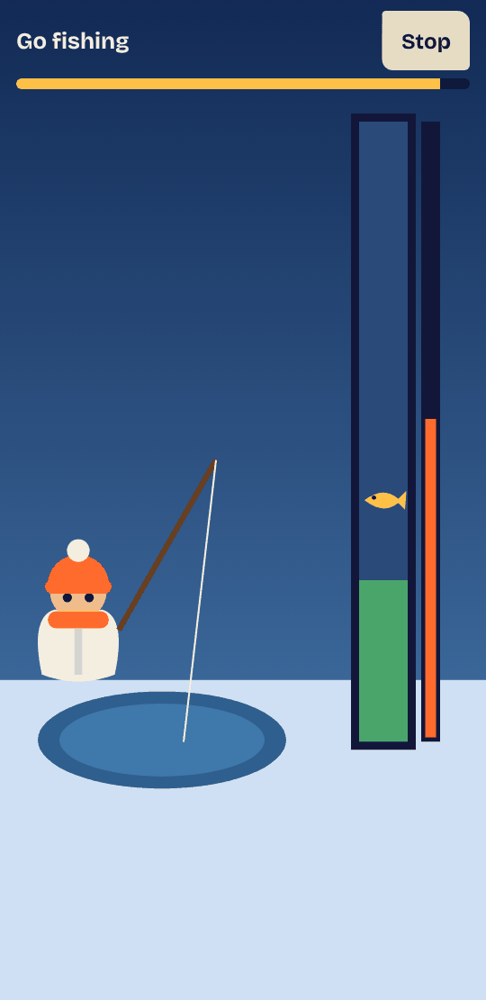 Fishing | 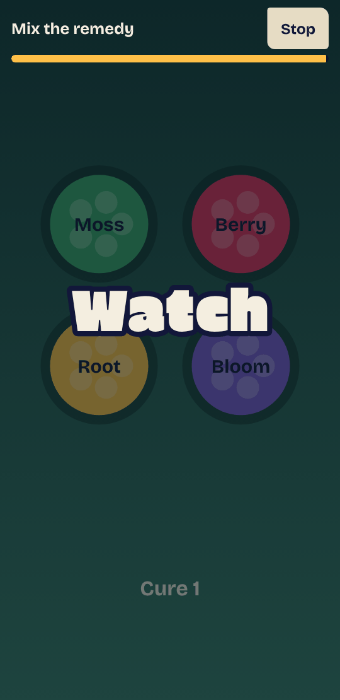 Mixing a remedy | 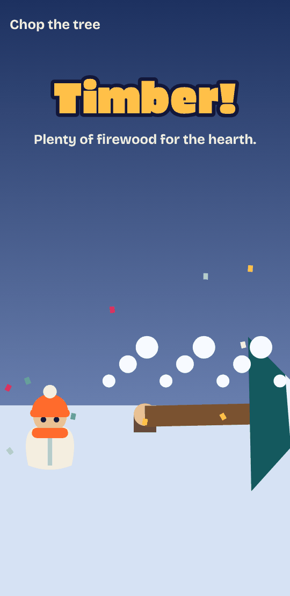 A job well done |
|  A raid begins | 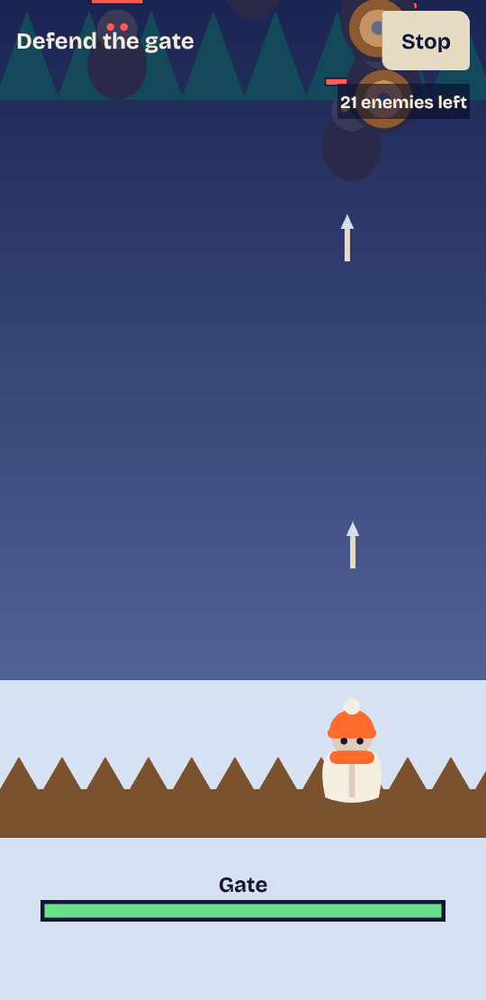 Defending the gate | 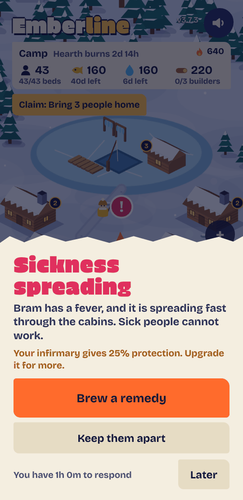 Sickness spreading |
| 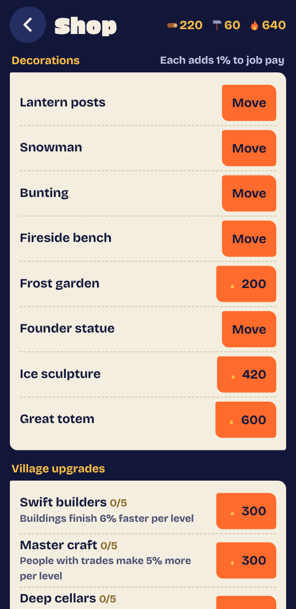 The shop | 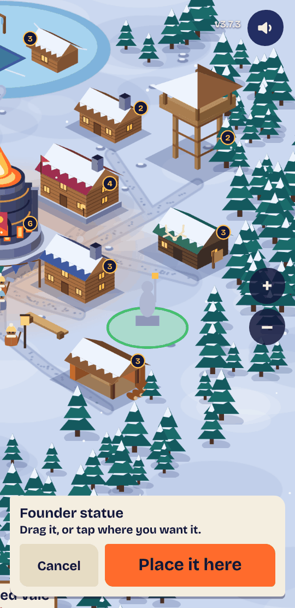 Placing a decoration | 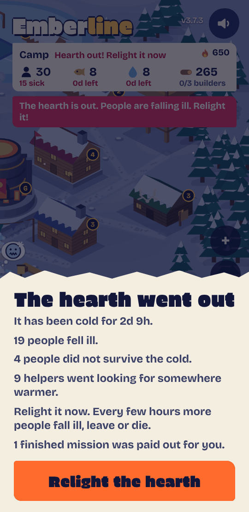 Coming back to a cold hearth |
| 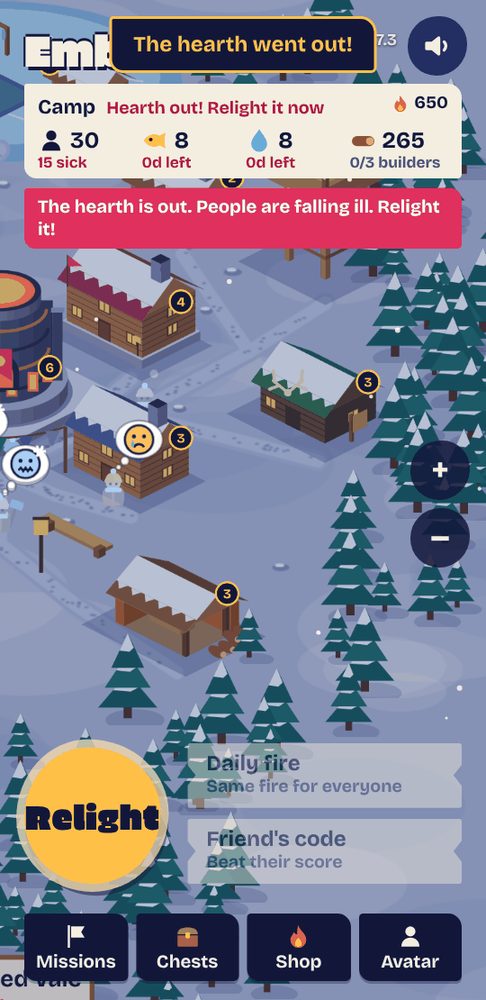 Freezing villagers | 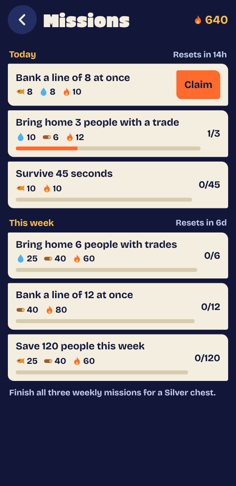 Missions | 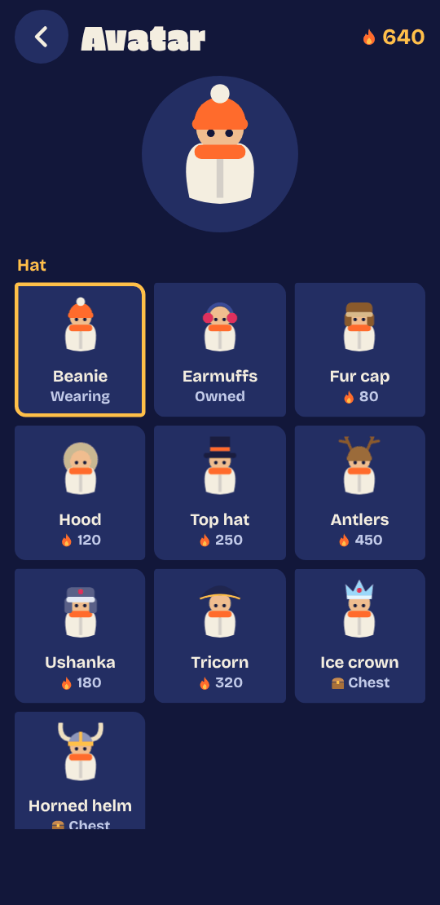 Avatar |
|  The first-run guide | | |

To retake these from the current build, run `node tools/build.js && node tools/readme-shots.js`.

---

## Updates

The full history, with every fix, is in [CHANGELOG.md](CHANGELOG.md).

| Version | Highlights |
|---|---|
| **3.8.0** | First-run guide that pauses and names each new thing; the campfire stays in the middle; much shorter instructions and event text. |
| **3.7.3** | Infirmary cues: "Watch" and "Your turn" now show as big words that fade away. |
| **3.7.2** | Stoking stays on screen on short phones; "Raid X" opening banner and a smaller enemy count; ice strain never eases. |
| **3.7.1** | Thought bubbles sit on villagers' heads; gentler, individual shivering; fixed buildings sometimes drawn as black circles. |
| **3.7.0** | Villager thought bubbles and moods; frozen looks when the hearth is out; raid-only "Gear up" shop. |
| **3.6.0** | The hearth as lifeline (illness, leaving, deaths, relight first); spreading sickness; troubles every few minutes; raids that grow tougher, with new enemy types and bow jams. |
| **3.5.1** | Version number shown in the game, this changelog, and iPhone home-screen support. |
| **3.5.0** | Six raid upgrades; Big raids and Warbands; hammer timing and hearth-stoking fixes. |
| **3.4.0** | Place decorations anywhere; a success scene for every mini-game; new land bought from the map; wolves go for villagers first. |
| **3.3.0** | 17 mini-games, four new lands, raids, the Shop, and wolves that chase you. |
| **3.2.0** | Mini-games remade to match their tasks; rhythm hammering; smoother villager movement. |
| **3.1.0** | Village events, injuries and the first mini-games. |
| **3.0.0** | The 2.5D village, chests and the Golden Aurora. |
| **2.0.0** | Missions, population and needs, specialists and avatars. |
| **1.0.0** | First playable: the rescue-line game with instant replay. |

Numbers follow MAJOR.MINOR.PATCH:
- **Major** changes the kind of game or replaces a core system.
- **Minor** adds or remakes gameplay.
- **Patch** is fixes and tuning only.

---

## Play it

The whole game is one file, `www/index.html`. The art, fonts, sound and code are all built in.

- **In a browser:** host `index.html` on any HTTPS site, such as GitHub Pages, and open the link.
- **On iPhone:** open the link in Safari, then tap **Share → Add to Home Screen** to play full screen.

Progress is saved in each browser on its own, so your phone and your computer each keep their own village.

---

## For developers

HTML5 canvas, no libraries, about 360 KB in total. Tuning lives in the constants at the top of
`src/village.js` (T, ROLES, BUILD) and `src/sim.js` (C). The village never changes a run, so daily
and challenge scores stay comparable.

### Layout
    src/sim.js     Rules. Pure, seeded, integer-only. Can run unchanged on a server.
    src/village.js People, needs, buildings, missions, avatar rules. Pure; time is passed in.
    src/mini.js    Mini-games for events and jobs.
    src/iso.js     The 2.5D village: building art, camera, gestures, walkers.
    src/meta.js    Building panel, overview, missions, chests and avatar screens.
    src/store.js   Saves. Swap this file's internals to go online.
    src/art.js     Paper cut-out art, painted once into sprites.
    src/game.js    Input, drawing, sound, screens.
    www/           The only folder that ships in the app.
    docs/          README screenshots.

### Commands
    node tools/build.js        # writes dist/ and www/
    node tools/test-sim.js     # run rule tests
    node tools/test-village.js # village, needs, missions, avatar tests
    node tools/economy.js      # weeks of village life with simulated players
    node tools/balance.js      # difficulty, using simulated players
    node tools/greed.js        # does waiting for a longer line pay?
    node tools/readme-shots.js # retakes the README screenshots

Browser tests (need Playwright):

    node tools/smoke.js         # every run flow, phone-sized, CPU throttled
    node tools/smoke-meta.js    # needs, missions, avatar, skipping days
    node tools/smoke-iso.js     # 2.5D village, gestures, upgrades, chests
    node tools/smoke-events.js  # events, jobs and every mini-game
    node tools/smoke-mini.js    # villager movement; each mini-game played well and badly
    node tools/smoke-place.js   # success scenes, raids ending, decorations, new land, wolves
    node tools/raid-balance.js  # a bot plays raids at each stage, with and without upgrades
    node tools/smoke-hearth.js  # cold hearth losses and relighting, troubles, raid jams and enemy kinds
    node tools/smoke-mood.js    # thought bubbles and cold looks, raid-only shop, button spacing
    node tools/smoke-games2.js  # stoking on short phones, ice strain, raid banner
    node tools/smoke-guide.js   # first-run guide: pause, zoom and name each new thing, once
    node tools/smoke-floor.js   # floors stay pixel-identical when someone walks behind a building

### Versioning
Every release gets a new number in `package.json` and an entry in `CHANGELOG.md`; the build stops
without one. The build also refuses two functions with the same name in one file. `VERSION` in
`src/sim.js` and the save version are separate: change those only when run rules or the save
format change.

### Android build (not run yet)
    npm i @capacitor/core @capacitor/android && npm i -D @capacitor/cli
    npx cap add android && npx cap sync android

### iPhone build (not run yet)
On a Mac with Xcode 26 or later and Node 22 or later:

    npm i @capacitor/core @capacitor/ios && npm i -D @capacitor/cli
    npx cap add ios && npx cap sync ios && npx cap open ios

### Before release
- Measure on a real entry-level phone. The numbers so far come from a throttled desktop browser.
- Search Google Play and the App Store for the exact title; a web search is not proof it is free.
- Create the upload key, back it up off this machine, enrol in Play App Signing.
- Replace localStorage with @capacitor/preferences inside store.js: Android WebView can lose
  localStorage written just before a hard kill, and iOS can clear web storage after long disuse.
- Check phone text size at 1.15x and 1.3x.

### Rule deliberately broken
The mobile-game-dev playbook says to avoid animated full-screen canvases. A real-time game needs a
moving layer, so the moving canvas covers only the board, the backdrop is one static image, every
sprite is pre-painted, and quality drops automatically on slow phones.

## Credits
Erica One and Bricolage Grotesque, SIL Open Font License (assets/fonts). All art and sound are
generated in code.
